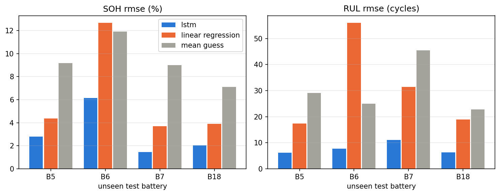
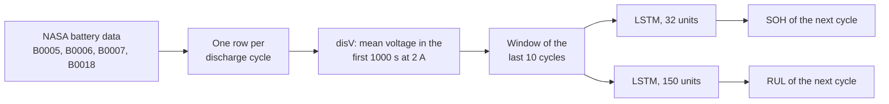
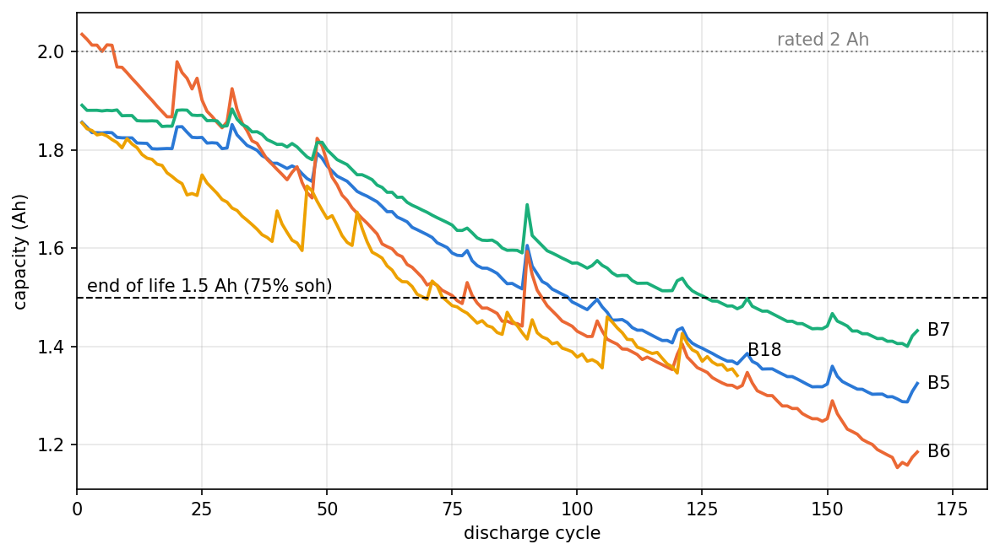
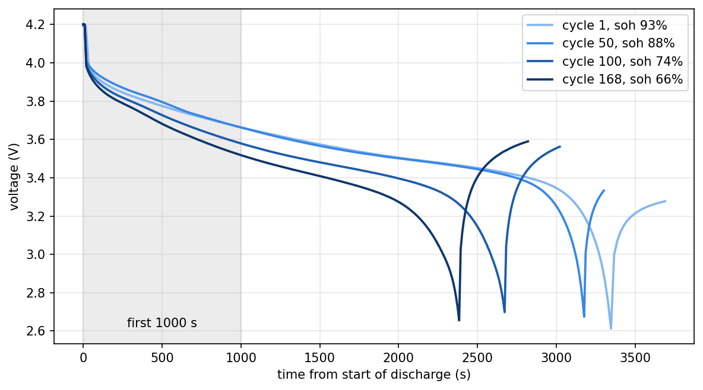
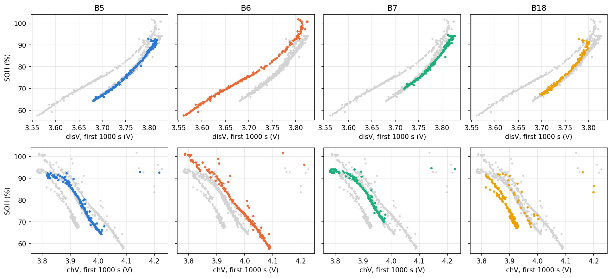
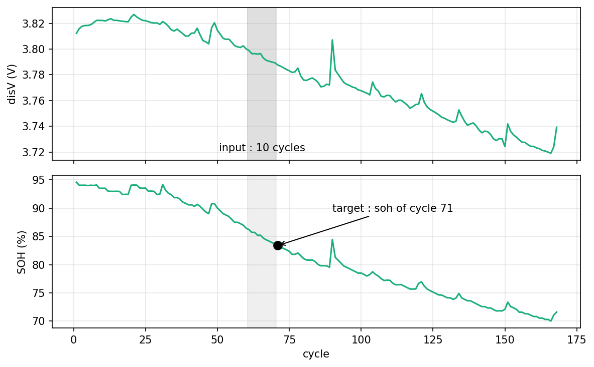
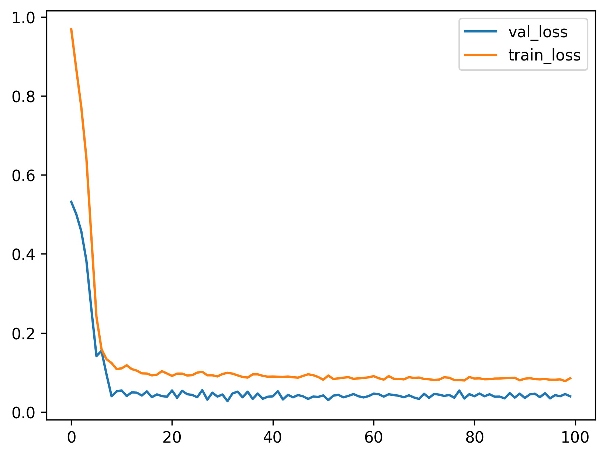
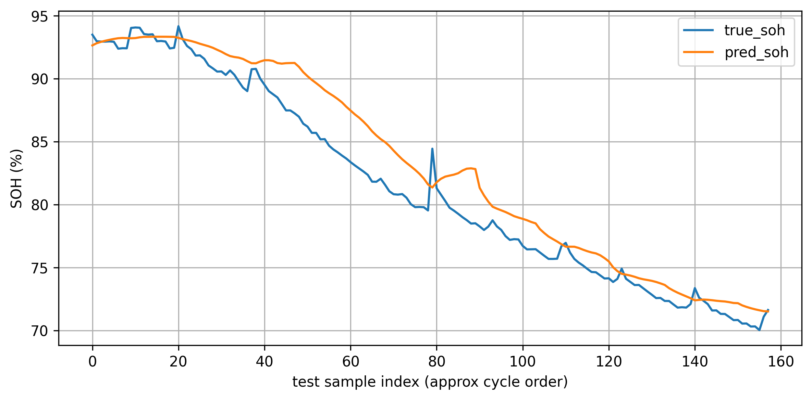
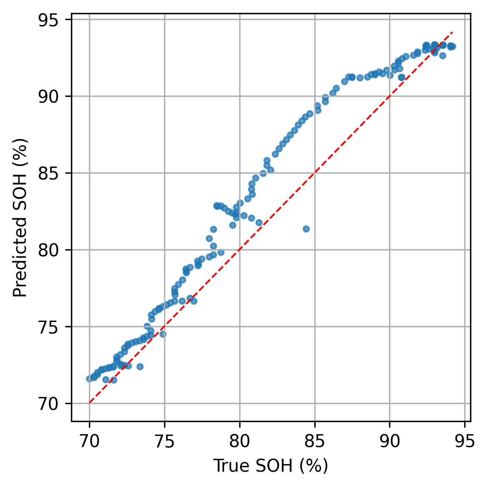
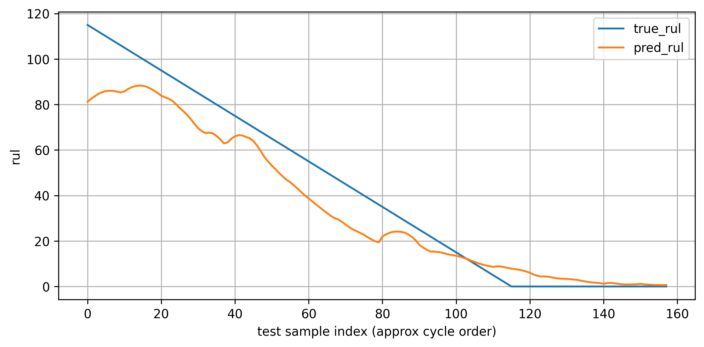

# Li-ion Battery SOH and RUL Prediction with LSTM (NASA data)

This project estimates the State of Health (SOH) and Remaining Useful Life (RUL) of Li-ion 18650 cells from NASA ageing data. Every model is tested on a cell it has never seen.

The model uses one physical signal: the cell voltage under a 2 A load in the first 1000 s of each discharge. As a cell ages, its internal resistance goes up and its capacity goes down, so this voltage sags.



*Error on each battery when that battery is left out of training (lower is better). Blue = LSTM, orange = linear regression, grey = always guessing the training average.*

## Results

Each of the 4 cells takes one turn as the unseen test cell. The model trains on the other 3 cells. Numbers are RMSE.

| Test cell | SOH, LSTM (%) | SOH, linear (%) | SOH, mean guess (%) | RUL, LSTM (cycles) | RUL, linear (cycles) | RUL, mean guess (cycles) |
|---|---|---|---|---|---|---|
| B0005 | 2.79 | 4.38 | 9.18 | 6.31 | 17.37 | 29.13 |
| B0006 | 6.25 | 12.66 | 11.90 | 6.98 | 55.95 | 24.95 |
| B0007 | 2.04 | 3.71 | 8.99 | 9.76 | 31.34 | 45.39 |
| B0018 | 2.15 | 3.89 | 7.11 | 6.80 | 18.92 | 22.75 |
| **Average** | **3.31** | 6.16 | 9.30 | **7.46** | 30.90 | 30.56 |

- The LSTM beats both baselines on every cell, for both SOH and RUL.
- B0006 is the hardest cell. It ages on a different curve from the others (see section 2).
- All numbers come from one run with `torch.manual_seed(0)`. On a GPU they can move a little, RUL most of all.

## How it works



1. Load the NASA data with `kagglehub`.
2. Turn each discharge cycle into one row of numbers.
3. Feed the last 10 cycles of `disV` to an LSTM.
4. Predict SOH (or RUL) of the next cycle, and compare with linear regression and a mean guess.

## 1. Data

This project uses the NASA PCoE Battery Data Set (B. Saha and K. Goebel, 2007, NASA Ames Prognostics Data Repository). The notebook loads the CSV copy on Kaggle, [`patrickfleith/nasa-battery-dataset`](https://www.kaggle.com/datasets/patrickfleith/nasa-battery-dataset), with `kagglehub`. For B0005, B0006 and B0007, the capacities in this copy match the original NASA `.mat` files exactly.

**Test conditions:**
- 18650 cells, rated capacity 2 Ah, room at 24 °C.
- Charge: constant current at 1.5 A up to 4.2 V, then constant voltage until the current falls to 20 mA.
- Discharge: constant current at 2 A down to a cut-off voltage (different for each cell, see table).



*Capacity of the 4 cells over their life. The small jumps up are capacity recovery after rest breaks in the NASA test. The dashed line is the end of life used in this project.*

| Cell | Discharge cycles | Capacity, first → last (Ah) | Discharge cut-off (V) | End of life (first cycle below 1.5 Ah) |
|---|---|---|---|---|
| B0005 | 168 | 1.856 → 1.325 | 2.7 | cycle 99 |
| B0006 | 168 | 2.035 → 1.186 | 2.5 | cycle 76 |
| B0007 | 168 | 1.891 → 1.432 | 2.2 | cycle 126 |
| B0018 | 132 | 1.855 → 1.341 | 2.5 | cycle 70 |

**How the targets are defined:**
- **SOH** = capacity ÷ 2 Ah × 100.
- **RUL** = cycles left until end of life. After end of life, RUL stays 0.
- **End of life** = the first cycle where capacity drops below 1.5 Ah (75% SOH). NASA used 1.4 Ah, but B0007 never drops below 1.4 Ah.

## 2. Feature: `disV`



*Discharge voltage of B0005 at 4 ages. The older cell sits lower from the start, so the mean voltage in the shaded first 1000 s (`disV`) tells how healthy the cell is. The jump at the end of each curve is the cell resting after the load switches off.*

**Why only the first 1000 s:**
- A healthier cell discharges for longer, because at a constant 2 A, time = capacity ÷ 2 A.
- So a mean over the whole curve would secretly measure capacity, which is the answer itself.
- The first 1000 s are inside the discharge for every cell at every age, so this window doesn't have that problem.

The notebook builds 6 features per cycle. Each is the mean over the first 1000 s of the charge before the discharge (`chI`, `chV`, `chT`) or of the discharge itself (`disI`, `disV`, `disT`). Only `disV` is used as model input:

| Feature | r with SOH (B0005 / B0006 / B0007 / B0018) | Used | Reason |
|---|---|---|---|
| chI | −0.13 / −0.14 / −0.14 / −0.07 | no | Set by the tester (1.5 A), not by the cell |
| chV | −0.79 / −0.89 / −0.75 / −0.37 | no | Shifts a lot from cell to cell (plot below) |
| chT | −0.26 / 0.03 / −0.04 / −0.19 | no | Follows room temperature more than ageing |
| disI | −0.63 / −0.73 / −0.66 / **+0.97** | no | Set by the tester (2 A). The sign flips on B0018, so it is test-machine drift, not health |
| disT | −0.56 / −0.66 / −0.38 / +0.15 | no | Follows room temperature, and the sign flips |
| **disV** | **0.99 / 0.99 / 0.99 / 0.98** | **yes** | Sags under load as the cell ages |

With all 6 features, the LSTM trained on B0005 + B0006 used `disI` as a shortcut. On B0007, whose `disI` lies outside the training range, the SOH error was 9.6%. With `disV` only, it was 2.2%.



*Each column shows one cell in color and the other three in grey. Top row: SOH vs `disV`. B5, B7 and B18 sit on almost the same curve, while B6 is on its own line, because it started above rated capacity (2.04 Ah) and was discharged to a different cut-off. Bottom row: SOH vs `chV`. B18 is shifted to the left of the others, which is why `chV` is not used. The few points near 4.2 V are first cycles, where the cell was already nearly full when charging started.*

## 3. Model



*One training sample. The input is `disV` of 10 cycles in a row (shaded). The target is SOH of the next cycle. The window slides one cycle at a time, so a cell with 168 cycles gives 158 samples.*

- **Input:** `disV` of the last 10 cycles, scaled with the mean and std of the training cells only.
- **SOH model:** LSTM (1 layer, 32 hidden units) → dropout 0.2 → linear. Trained for 100 epochs, batch 32.
- **RUL model:** same, with 150 hidden units. Trained for 500 epochs, batch 52.
- **Training:** Adam (learning rate 0.001, weight decay 1e-4) with MSE loss.
- **Baselines:** linear regression on the same 10-cycle window, and a "mean guess" that always predicts the training average.



*Loss of the SOH model while training on B0005 + B0006. `val_loss` is the B0007 loss, which was not used to pick anything. It sits below the training loss because the training set includes the harder B0006, and dropout is only active during training.*

## 4. Fixed split: train B0005 + B0006, test B0007

The main part of the notebook uses this split. The leave-one-cell-out table above comes from the last section of the notebook.

| | LSTM | Linear | Mean guess |
|---|---|---|---|
| SOH RMSE (%) | 2.23 | 4.18 | 8.98 |
| RUL RMSE (cycles) | 14.3 | 30.3 | 44.7 |



*SOH of B0007 in cycle order. In mid-life the model is up to about 4% too high, and it smooths over the jumps after rest breaks.*



*Each dot is one cycle of B0007. Dots on the red dashed line would be perfect.*



*RUL of B0007. Early in life the model predicts about 80 cycles when the truth is about 115, because B0007 ages slower than B0005 and B0006. After end of life (cycle 126), the true RUL stays 0.*

## Earlier version of this project

The first version used a Kaggle CSV (`Battery_dataset.csv`) whose cells are also called B5, B6 and B7. It had two problems.

1. **Leakage.** In every row, SOH = 50 × BCt, and BCt (capacity) was a model input. RUL + cycle was constant for each cell, and cycle and battery ID were inputs too. So the model was given the answer, and the old scores meant nothing.
2. **No real signal.** After those inputs were removed and the model was tested on B7, the LSTM did worse than guessing the average SOH (RMSE 21.4% vs 17.9%). In that file, none of the 6 remaining features followed SOH (|r| ≤ 0.19).

That file also does not match the original NASA data. It has 220 / 210 / 250 cycles instead of 168. Its capacity goes down to 0.75 Ah, while NASA stopped the test near 1.4 Ah. And it shows discharge voltages up to 4.36 V, which is above the 4.2 V charge limit. That is why this version uses the real NASA data.

## Limits

- **Very little data.** Only 4 cells, all the same type, at the same room temperature and the same 2 A load. A real EV pack sees changing loads and temperatures.
- **Needs a fixed load.** `disV` needs the first 1000 s of a 2 A constant-current discharge. A real BMS rarely gets that. It would need a fixed test pulse or a similar known load.
- **Feature choice was not blind.** `disV` was picked after comparing a few feature sets on these same 4 cells, so a brand-new cell may do a little worse than the tables above.
- **RUL depends on ageing speed.** RUL from a single cell's state can't know how fast that cell will age from now on. That is why B0007, the slowest-ageing cell, gets too little remaining life early on.
- **Unused LSTM dropout.** `dropout=0.2` inside `nn.LSTM` does nothing with 1 layer (PyTorch prints a warning). Only the dropout before the linear layer is active.

## How to run

```
pip install -r requirements.txt
```

Open `battery_life_cycle.ipynb` and run all cells.

- **Download:** the first run downloads about 228 MB through `kagglehub`. This public dataset downloaded without a Kaggle login when tested.
- **GPU:** the notebook calls `.cuda()`, so it needs an NVIDIA GPU with CUDA PyTorch. On a CPU-only machine, remove the `.cuda()` calls.
- **Run time:** a full run, including the leave-one-cell-out check, took about 2 minutes on a laptop CPU.
- **Plots:** every image in this README is saved by the notebook into `images/`.

## Files

- `battery_life_cycle.ipynb`: data loading, features, training, baselines, the leave-one-cell-out check, and all plots
- `images/`: plots saved by the notebook
- `requirements.txt`: Python packages needed to run the notebook
